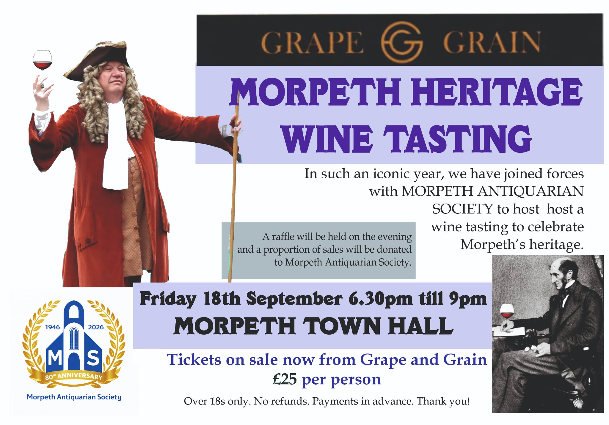
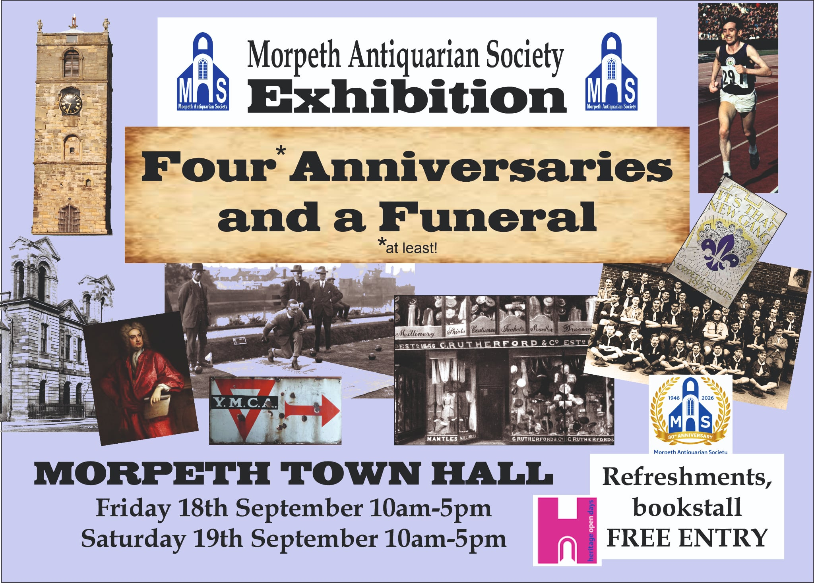
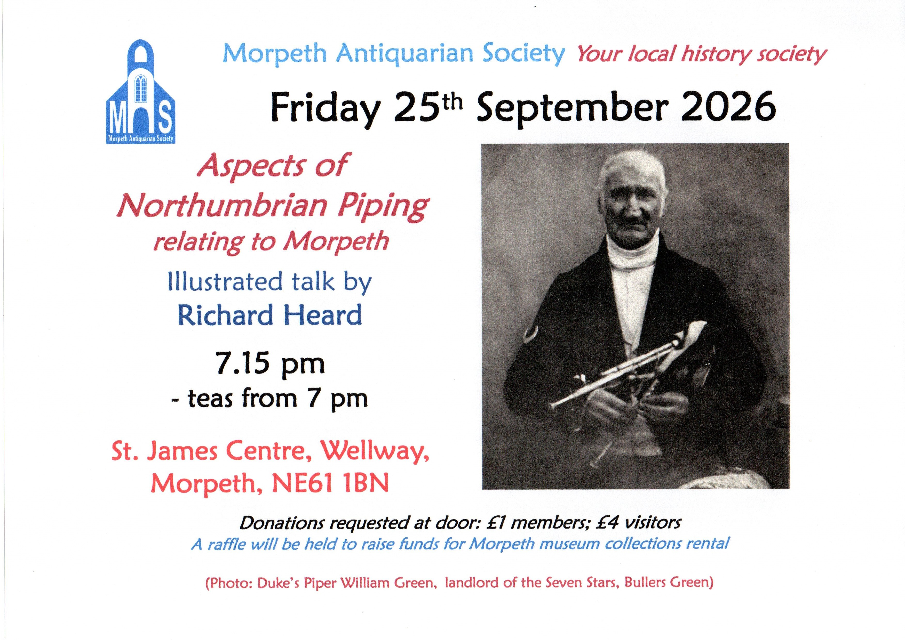

# Northumbriana Events

Click to **[view this year's Gathering programme](../gathering/programme)**

Click here for **[press release (PDF)](pdfs/press-release.pdf)**

## Morpeth Antiquarian Society 80th Birthday Afternoon Tea

*A Saturday in the Summer (details to be announced)*

## Heritage Open Days

*Thursday 17th to Sunday 20th September 2026*

Events including Morpeth Antiquarian Society’s annual local history exhibition featuring Sir John Vanbrugh’s 300th anniversary and Morpeth Town Hall – send us your memories of community and civic events held there.

Includes evening reception and wine-tasting by Grape and Grain reflecting Northumbrian heritage

## Morpeth Heritage Wine Tasting

## Morpeth Antiquarian Society Exhibition

## Aspects of Northumbrian Piping

## Northumbrian Language Society presents

Annual Roland Bibby Memorial Dialect Lecture

Delivered by Paul Mein

*Saturday 10th October 2026 at 2 pm, Morpeth Town Hall*

